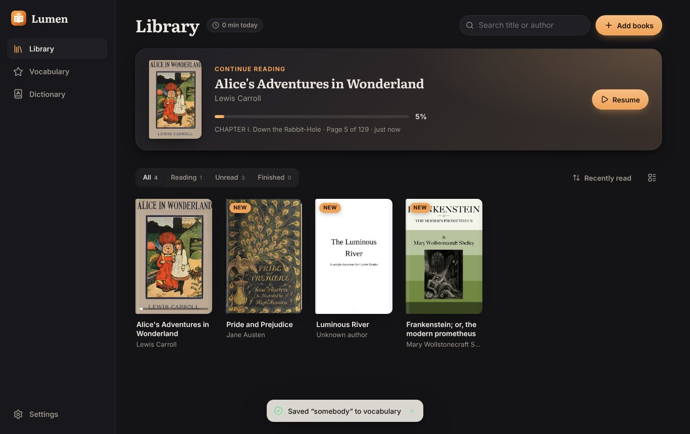
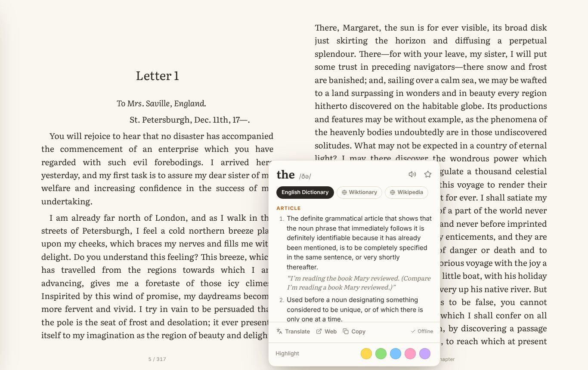
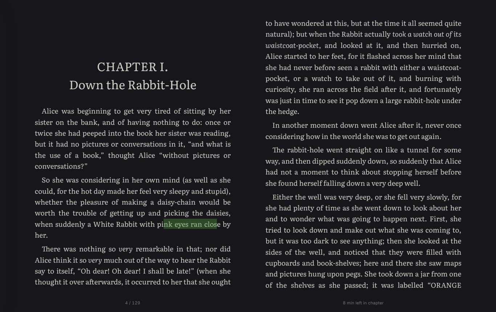
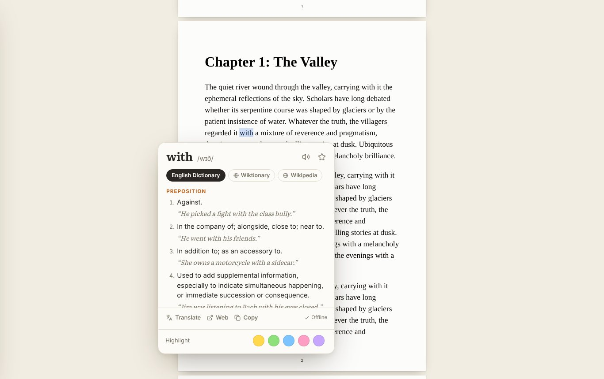
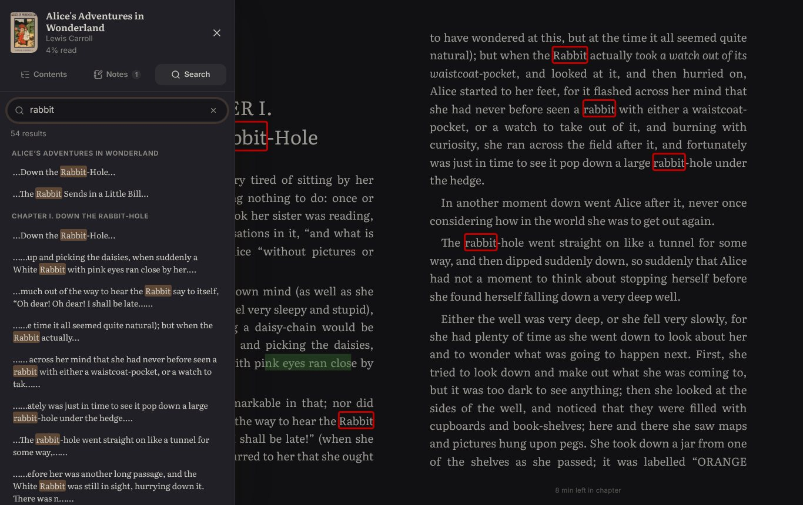
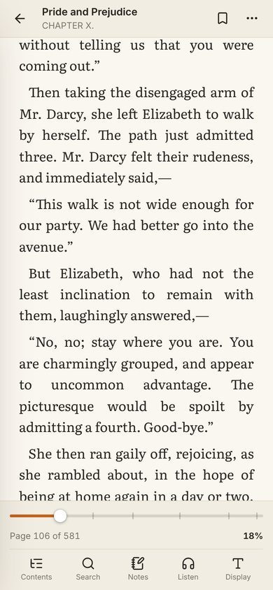

# Lumen Reader

A calm, fast ebook reader for **desktop (Electron)** and **Android (Capacitor)**. It opens EPUB, PDF, MOBI/AZW3, FB2 and CBZ files and includes **offline English dictionaries** built from Wiktionary, WordNet and Webster's 1913 (280,000+ words and phrases). Double-click (or long-press) any word to look it up, even without internet.



| Instant offline dictionary | Night theme with highlights |
| --- | --- |
|  |  |

| PDF with lookup | Search in book | Phone |
| --- | --- | --- |
|  |  |  |

## Features

**Reading**
- EPUB 2/3, MOBI/AZW3 (KF8), FB2/FBZ, CBZ, fixed-layout EPUB (rendered with [foliate-js](https://github.com/johnfactotum/foliate-js)), and PDF (rendered with [PDF.js](https://mozilla.github.io/pdf.js/)).
- Paginated two-column layout on wide screens or continuous scroll, with page-turn animation, running header, page numbers and "minutes left in chapter".
- 7 themes (Light, Paper, Sepia, Sage, Dusk, Night, Black), plus a brightness dimmer.
- Typography: 8 bundled fonts (Literata, Source Serif, Merriweather, Inter, Atkinson Hyperlegible, OpenDyslexic, and system fonts), size, weight, line spacing, letter spacing, paragraph spacing, margins, line length, justification and hyphenation.
- PDF: continuous or page-by-page scrolling, two-page spreads, fit width / page / text (trims the margins), pinch, double-tap (zooms into the column) and Ctrl+wheel zoom, page tinting that follows the theme (sepia, inverted night mode), selectable text. Each PDF remembers its zoom and position, and turning pages keeps the column you're reading in view.
- **Flowing text** for PDFs (`V`): the PDF's text is rebuilt as an ebook, with paragraphs, headings and figures, so it follows your font, size and theme on any screen. Running headers and page numbers are dropped and hyphenated words rejoined. Highlights, bookmarks and your place carry over between flowing text and the original pages.
- Tap/click zones, swipe, mouse wheel and full keyboard control (press `?` in the reader).
- Table of contents, full-text search with highlighted results, footnote popups, a "Back to page X" chip after jumps, and reading position restore.

**Dictionary and language**
- Built-in offline dictionaries (about 51 MB):
  - **Wiktionary**: 177,000 English headwords plus 230,000 inflected, archaic and alternative forms, with usage labels (*transitive*, *archaic*, *botany*…), examples, synonyms, irregular forms, US/UK IPA, word origins, and recorded pronunciations from Wikimedia Commons (played when online).
  - **WordNet 3.1**: concise definitions with synonyms and opposites, plus CMU Pronouncing Dictionary IPA.
  - **Webster's Revised Unabridged Dictionary (1913)**: 102,000 entries with full, literary definitions, quotations, synonyms and phrases; good for older books (public domain).
  - **English–Korean** (from the Korean Wiktionary, 15,000 words), and translations of 40,000 common words into 21 languages, shown for the language picked under *My language*.
- Understands inflections and old spellings (`running → run`, `geese → goose`, `went → go`, `hath → have`, `colour → color`, `'tis`, `o'er`) and offers "did you mean" suggestions.
- Senses come in reading order: the part of speech a word is mostly used as first (*bear* → verb, *still* → adverb), then common meanings, with obsolete, rare, slang and specialist senses last. Frequencies come from WordNet's tagged corpus, which also fills in a few frequent meanings the distilled Wiktionary entries lack (*set* → a collection).
- The dictionary card opens on the dictionary you picked last (per book language) or on the default chosen in Settings, and stays there: when it has no entry for a word, or can't be reached, it says so and shows another dictionary's entry below. Each built-in dictionary can be turned off.
- Import **StarDict** dictionaries (`.ifo/.idx/.dict(.dz)`, or `.zip`/`.tar.gz`) for any language. `.dict.dz` files are read with random access, so big dictionaries stay fast.
- Optional online sources: Wiktionary.org (all languages), Wikipedia and recorded pronunciations, plus one-tap Google Translate and links to Merriam-Webster, Cambridge, Oxford Learner's, Collins, Longman, Dictionary.com, Vocabulary.com and Etymonline.
- Save words to **Vocabulary** with the sentence you found them in, review them as flashcards, and export to CSV (Anki-friendly).

**Notes and more**
- Highlights in 5 colors with notes, bookmarks, a Notes panel, and Markdown export.
- **Read aloud** with sentence highlighting and automatic page turns (Web Speech on desktop, the native TTS engine on Android).
- Reading time and daily streak, "Continue reading", library search, filters, sort, and grid or list view.
- Backup and restore of progress, highlights, vocabulary and stats as JSON.
- Everything stays on the device (IndexedDB). No account or tracking.

## Getting started

Requirements: Node.js 20+ (22 recommended).

```bash
npm install
npm run dev            # web version at http://localhost:5173
npm run electron:dev   # desktop app with hot reload
```

`npm run dev` and `npm run build` first run `scripts/prepare.mjs`, which compiles the offline dictionaries into `public/dict/` (about a minute, and only when they or their sources change) and copies PDF.js assets into `public/pdfjs/`. Both folders are generated and git-ignored.

### Desktop packages

```bash
npm run dist:linux   # AppImage + .deb   → release/
npm run dist:win     # NSIS installer
npm run dist:mac     # .dmg
```

The packages register file associations for `.epub`, `.pdf`, `.mobi/.azw3`, `.fb2` and `.cbz`, so "Open with…" and double-clicking a book opens it in Lumen.

### Android

Requirements: JDK 21 and the Android SDK (Android Studio installs both). Set `ANDROID_HOME` if Gradle can't find the SDK.

```bash
npm run android:apk        # build web app → sync → android/app/build/outputs/apk/debug/app-debug.apk
npm run android:open       # open the project in Android Studio
```

For a signed release build, set `LUMEN_KEYSTORE`, `LUMEN_KEYSTORE_PASSWORD`, `LUMEN_KEY_ALIAS` and `LUMEN_KEY_PASSWORD`, then run `npm run android:release`. The app registers as a handler for ebook and PDF files ("Open with Lumen Reader"), keeps the screen on while reading, and hides the system bars in the reader.

### Continuous integration

`.github/workflows/build.yml` type-checks the code, runs the end-to-end smoke test, then builds Linux/Windows/macOS packages and Android APKs as workflow artifacts. Add the `ANDROID_KEYSTORE_BASE64`, `ANDROID_KEYSTORE_PASSWORD`, `ANDROID_KEY_ALIAS` and `ANDROID_KEY_PASSWORD` secrets to get a signed release APK.

### Tests

```bash
npm run typecheck
npm run test:e2e   # builds, serves the app and drives it in Chromium (set CHROMIUM_PATH if needed)
```

## Before you publish

A few values are placeholders. Replace them with your own:
- `author`, `homepage` in `package.json` and `linux.maintainer` in `electron-builder.yml` (used by the `.deb`).
- `appId` (`app.lumenreader`) in `capacitor.config.ts`, `electron-builder.yml` and `android/app/build.gradle`, if you want a different package name.
- App icons are generated from `public/icon.svg` by `npm run icons` (needs Chromium via `playwright-core`).

## Project layout

```
electron/            main process (app:// protocol, file associations, menus) and preload bridge
android/             Capacitor Android project
scripts/
  build-dictionary.mjs     Wiktionary + WordNet + Webster + CMUdict → gzip shards in public/dict
  webster.mjs              parses Webster's 1913 into the same entry format as Wiktionary
  sense-order.mjs          puts senses in reading order using WordNet's corpus frequencies
  distill-wiktionary.mjs   distills kaikki.org Wiktionary dumps into data/wiktionary (run when updating)
  prepare.mjs              runs the dictionary build and copies PDF.js assets
  generate-icons.mjs       desktop and Android icons from public/icon.svg
data/wiktionary/     distilled Wiktionary data (CC BY-SA 4.0), input to build-dictionary.mjs
src/
  App.tsx                  shell, navigation, import, drag & drop, Android back button
  library/                 library grid/list, covers, details
  reader/
    Reader.tsx             reader UI shared by all formats
    epub-engine.ts         foliate-js engine (EPUB/MOBI/FB2/CBZ)
    pdf-engine.ts          PDF.js engine (original pages)
    pdf-flow.ts            PDF → reflowable book conversion for flowing text
    pdf-flow-engine.ts     flowing-text engine (foliate-js reading the converted PDF)
    read-aloud.ts          sentence-by-sentence TTS controller
  dictionary/              dictionary card and Dictionary page
  lib/dictionary/          Wiktionary + WordNet lookup and lemmatizer, StarDict reader, online sources, sanitizer
  lib/db.ts                IndexedDB storage (books, files, annotations, vocabulary, stats)
  vendor/foliate-js/       vendored foliate-js (MIT)
tests/smoke.mjs            end-to-end test
```

## Licenses

Lumen Reader is MIT licensed. Bundled data and libraries keep their own licenses:
Wiktionary content from the English and Korean editions via kaikki.org (CC BY-SA 4.0, see `public/dict/LICENSES.txt` after building), WordNet 3.1 (WordNet License), Webster's Revised Unabridged Dictionary (1913, public domain, via Project Gutenberg), CMU Pronouncing Dictionary (BSD), foliate-js (MIT), PDF.js (Apache-2.0), and the fonts (SIL Open Font License).
